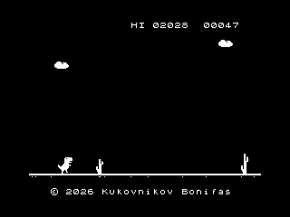

# ZX Dino

A dinosaur runner in the style of the Chrome offline game, for the ZX Spectrum 48K. The game is Z80 assembly. Sprites are ASCII pictures in `art.py`.



## Play

Open `dino.tap` or `dino.z80` in a 48K emulator. The same files are used on macOS, Linux, and Windows.

The TAP file starts with a BASIC loader. It loads the code at address 32768 (`$8000`) and runs it. The Z80 snapshot starts at the same address. A real Spectrum 48K loads the TAP through its tape input.

## Platforms

The game is a ZX Spectrum 48K program. You run it in an emulator. Building the TAP and Z80 images works on macOS, Linux, and Windows. The extra preview frames are set up for macOS and Linux.

### macOS

[Fuse](https://fuse-emulator.sourceforge.net/) opens `dino.tap` and `dino.z80`. The 48K ROM that ships with Fuse for macOS is `Fuse.app/Contents/Resources/48.rom`. For preview frames, set `SPECTRUM_ROM` to that file or copy it to `48.rom` in this directory.

Install Python 3 and the assembler with `brew install z80asm`, then run `python3 build.py`. That formula is [z80asm](https://www.nongnu.org/z80asm/) 1.8, not the z88dk toolkit. Preview frames also need the Xcode command line tools, which provide `cc`, and the [libz80](https://github.com/ggambetta/libz80) sources unpacked at `/tmp/libz80-master`.

### Linux

Fuse opens the TAP and Z80 the same way. On Debian and Ubuntu the package is `fuse-emulator`. The separate package `spectrum-roms` installs the 48K ROM at `/usr/share/spectrum-roms/48.rom`. Point `SPECTRUM_ROM` at it, or copy it to `48.rom`.

On Debian and Ubuntu, `apt install z80asm` provides the same assembler. Build with Python 3 and `python3 build.py`. Preview frames need `cc` (GCC or Clang) and libz80 unpacked at `/tmp/libz80-master`.

### Windows

Open the TAP or Z80 in Fuse for Windows, or another 48K emulator. Copy that emulator's `48.rom` into this directory, or set `SPECTRUM_ROM` to it, when you want preview frames.

Under WSL, `apt install z80asm` and then the Linux build. A native prompt works once `python` and `z80asm` 1.8 are on `PATH`:

```bat
python build.py
```

Preview frames are compiled with the Unix command `cc` and libz80 is read from `/tmp/libz80-master`, so that step runs on macOS and Linux. On Windows the script still writes the TAP and Z80 images. Under WSL, follow the Linux steps.

## Controls

Any key starts a run. SPACE or Q jumps. A or CAPS SHIFT ducks, so a low bird passes overhead. The title lists the keys, and GAME OVER shows HIT ANY KEY.

After a collision, release the key, then press any key to start the next run.

The score counts up while you run. The high score lasts until you reset the machine. The screen flips between day and night as the score climbs, and the run keeps speeding up with it.

## Demo

The same `dino.tap` and `dino.z80` include an attract mode. The source is `dino.asm`.

The title stays up for 5 seconds. Any key during that time starts your own run. If you wait, the dinosaur plays by itself and the screen shows DEMO. It jumps late enough that one jump clears a cactus, ducks under low birds, and runs under high birds.

Any key stops the demonstration and returns to the title. Release the key, then press any key to play yourself. If you leave the title alone for another 5 seconds, the demonstration starts again.

The same 5 second wait applies after GAME OVER. If you do not restart, the demonstration takes over. When the demonstration itself crashes, it starts another run after a short pause.

## Build

You need Python 3 and [z80asm](https://www.nongnu.org/z80asm/) 1.8. On macOS that is `brew install z80asm`.

```sh
python3 build.py
```

The script rebuilds `sprites.inc` from `art.py`, assembles `dino.asm`, and writes `dino.bin`, `dino.tap`, and `dino.z80`.

To change a sprite, edit its picture in `art.py`. Every row of a sprite must be the same width, and the width must be a multiple of 8.

The same command can render preview frames. See [Platforms](#platforms) for the C compiler, libz80, and the 48K ROM on each system. The ROM is copyrighted and is not part of this repository. If `48.rom` and `SPECTRUM_ROM` are both unset, the TAP and Z80 images are still written and the preview is skipped.

## License

MIT. See [LICENSE](LICENSE).
